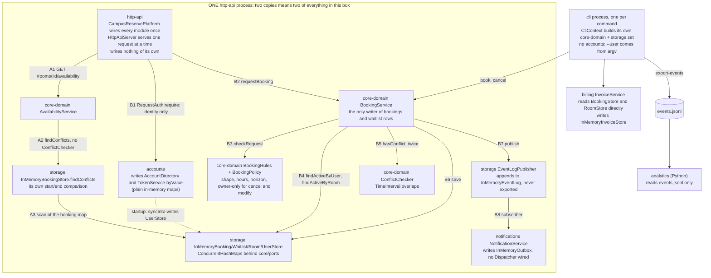

# BOUNDARIES.md

One section per milestone, filled in order. Every claim says how it was
checked. File and line references are to the starter as shipped (commit
`70698c4`); no production code or test was changed.

---

## Milestone 1: The architecture as built

**The sketch.** Drawn from the wiring in `CampusReservePlatform` and
`CliContext` and from the imports and callers of each class. `A1..A3` is an
availability request, `B1..B8` a booking request. Everything inside the big
box exists once per HTTP process, so two copies have two of everything in it.



What each module writes, and the two edges that carry code rather than data:

| Module | Writes |
|---|---|
| `core-domain` | bookings and waitlist rows (only `BookingService`), rooms (`RoomCatalog`), users (`UserRegistry`), all through `core/ports` |
| `storage` | the maps behind every port, and the event log (`EventLogPublisher` appends to `InMemoryEventLog`) |
| `accounts` | its own two maps, plus the booking domain's `UserStore` once at startup (`AccountDirectory.syncInto`, `CampusReservePlatform.java:144`) |
| `notifications` | `InMemoryOutbox` only; `delivery/Dispatcher` has no caller in production code |
| `billing` | `InMemoryInvoiceStore`, which `extends` storage's `InMemoryRecordStore` (that base class is billing's only storage import) |
| `http-api` | nothing; `JsonObject` borrows storage's `JsonLine.escape` (`JsonObject.java:96`), the other reason it imports storage |
| `cli` | `events.jsonl` (`ExportEventsCommand`) |
| `analytics` | reports to stdout |

**Where your sketch and `ARCHITECTURE.md` disagree.**

1. Availability. `ARCHITECTURE.md` routes conflict checks through
   `ConflictChecker` to `TimeInterval.overlaps`, "the only overlap
   implementation", and `AGENTS.md` rule 3 lists availability among its users.
   I drew availability going around both, to a second overlap test inside
   storage (`InMemoryBookingStore.java:61-62`).
2. Ownership. `ARCHITECTURE.md` draws "owner check via accounts" on the booking
   path and says `RequestAuth` is where authorization is decided. I drew the
   owner decision for cancel, modify, and leaving the waitlist in core-domain
   (`BookingRules.java:126`); accounts only answers "who is this" on those
   routes, and decides ownership only for reads.
3. The CLI. `ARCHITECTURE.md` draws `BookCommand` passing through the same
   "owner check via accounts" box as the HTTP handler. I drew the CLI with no
   accounts at all.
4. The event log. `ARCHITECTURE.md` says the log is "the one thing that can
   outlive a process" because `JsonlFileEventLogWriter` appends to a file. I
   drew the HTTP server's log as a dead end: in memory, never written out, so
   analytics never sees a booking made over HTTP.

**How you decided which one is right.** In each case the code is right and the
document is stale.

1. `grep -rn "\.overlaps(" */src/main` finds three calls, all inside
   `ConflictChecker`. `AvailabilityService` no longer imports `ConflictChecker`;
   `isFree` and `busyIntervals` call `BookingStore.findConflicts`
   (`AvailabilityService.java:35,41`). Diffing against my Lab 8 fork shows this
   is the "performance work": Lab 8's `AvailabilityService` still used
   `conflictChecker.hasConflict`. The two predicates agree today (same
   `start < otherEnd && otherStart < end` expression; storage's
   `FindConflictsTest` pins the half-open edges). But core-domain's test fake
   (`InMemoryStores.java:111`) answers `findConflicts` with
   `TimeInterval.overlaps`, so `AvailabilityServiceTest` never runs the
   storage copy. That is the lecture's "rule copied into a query".
2. Callers of `requireActingFor`: `BookingsHandler` show and list, and
   `WaitlistHandler` list. `cancel` and `modify` call only `auth.require`
   (`BookingsHandler.java:109,134`) and get their 403 from
   `NOT_BOOKING_OWNER` through `ErrorMapping`. The test that pins it is
   `ModifyBookingEndpointTest.anAdministratorIsNotAnOwner` (line 102): an
   administrator's PATCH gets 403, which the accounts rule (`mayActFor` lets
   administrators through) would have allowed.
3. `cli/pom.xml` has no `accounts` dependency and no file in `cli/src/main`
   imports it. `BookingCommands.Book` passes `args.requireString("user")`
   straight to `BookingService`.
4. `StoreRegistry.withEventLogFile` has no caller outside storage's own tests
   (`grep -rn withEventLogFile`). `CampusReservePlatform.java:44` uses
   `StoreRegistry.inMemory()`, and nothing on the HTTP side calls
   `memoryEventLog()` or `writeTo`. Only a fresh CLI run exports a log.

---

## Milestone 2: Run it as copies

**Your stack.** `compose.yaml` at the repository root: `api` built from the
`Dockerfile` with no host port, `proxy` (nginx 1.30.6 with
`proxy/nginx.conf`, published on 8080), and `k6` (`grafana/k6:2.3.0`, profile
`load`, `./load` mounted at `/load`, no `depends_on`).

```
docker compose up -d --build --scale api=2
# wait ~8 s, then
bash load/run.sh tokens.js          # or: bash load/run.sh bookings.js
```

`load/run.sh` reads each copy's tokens from `docker logs` and runs
`docker compose --profile load run --rm --no-deps ... k6 run /load/<script>`.
Distinct `X-Upstream` values: **2**, `172.19.0.2:8080` (api-1) and
`172.19.0.3:8080` (api-2). Ten `curl -si localhost:8080/health` calls split 6
and 4; `tokens.js` lists both in every run. `bookings.js` skips the proxy, so it
counts distinct `remote_ip` values instead, and reports 2. Docker had 32 CPUs.

### Finding 1: tokens

**The claim.** A token works on any request, whichever copy answers it.

**The script and its result.** `load/tokens.js`. One VU sends 40
`GET /bookings` through `http://proxy` with u-1's token from one copy, and files
each answer under its `X-Upstream`. Threshold: `token_accepted: rate==1`.
`setup()` stops the run unless it sees N distinct `X-Upstream` values.

| Run | Answers | Threshold |
|---|---|---|
| 2 copies, api-1's token | 18 x 200 from `.0.2`, 22 x 401 from `.0.3` | ✗ rate=45.00% (exit 99) |
| 2 copies, api-2's token | 21 x 200 from `.0.3`, 19 x 401 from `.0.2` | ✗ rate=52.50% (exit 99) |
| 1 copy (`--scale api=1`) | 40 x 200 | ✓ rate=100% (exit 0) |

Names the claim: the metric is the claim. Seen it fail: yes, and seen it pass at
one copy, so the threshold can go both ways. Could it see the problem: yes,
every request goes through the proxy and `setup()` refuses to run on fewer
copies than expected. The 401 body is `{"error":"invalid_token","message":"token ZEjr..."}`.

**Why, from the code.** `TokenService` keeps tokens in
`private final Map<String, Token> byValue = new LinkedHashMap<>()`
(`TokenService.java:31`), and values come from `TokenMinter.random()`, 32
`SecureRandom` bytes, so no copy can derive another's. Each process builds its
own `new TokenService(accounts, clock, TokenMinter.random())`
(`CampusReservePlatform.java:53`), and `CampusReserveServer.main` issues the two
startup tokens into that map (`CampusReserveServer.java:35-36`). On the other
copy, `AuthorizationService.authenticate` finds nothing (`:43`) and denies with
`INVALID_TOKEN` (`:45`), which `RequestAuth` turns into the 401. Found by
following `BookingsHandler.create` → `RequestAuth.require` →
`AuthorizationService.authenticateHeader` → `TokenService.find`. The code in
the body, `invalid_token` rather than `expired_token`, matches the
"not on file" branch.

**The kind of problem.** State kept in one copy's memory. The service is not
stateless: session state (the token map) lives in the process that issued it,
so the copies are not interchangeable and about half of a user's requests get a
401.

### Finding 2: bookings

**The claim.** A room slot is booked at most once.

**The script and its result.** `load/bookings.js`. For each of 5 one-hour
slots in `r-1` a week out, one `http.batch` sends two `POST /bookings` at the
same moment: Ada (u-1) with api-1's token to `http://f26-lab09-api-1:8080`, and
Cass (u-2) with api-2's token to `http://f26-lab09-api-2:8080`. Thresholds:
`bookings_201: count==5` (one confirmation per slot) and
`slots_double_booked: count==0`. `setup()` stops the run if a token fails on its
own copy, if the room already has bookings that day, if a user is too close to
the cap of five, or if it reaches fewer than N distinct copies. `teardown()`
gives everything back, waitlist places first so nothing is promoted, which makes
the run repeatable on one stack.

| Run | Every slot | Thresholds |
|---|---|---|
| A on api-1, B on api-2 | `201` for u-1 **and** `201` for u-2, "booked twice" | ✗ count==5 count=10, ✗ count==0 count=5 (exit 99) |
| control, both on api-1 (`run.sh bookings.js 1 1`) | one `201`, the other `202 waitlisted` | ✓ both (exit 0) |

It reaches each copy directly by its container name, which `docker compose ps`
shows and Docker's DNS resolves on the stack's network. It has to: through the
proxy, about half of the POSTs would land on the copy that did not issue the
token and stop at a 401 (Finding 1), so the run would measure tokens again
instead of bookings. Seen it fail: yes, and the control shows it passes when one
store sees both requests. Could it see the problem: the two requests for a slot
always go to two different copies, at the same moment.

**Why, from the code.** `BookingService.requestBooking` is a check-then-insert.
It reads `bookings.findActiveByRoom(...)` and asks `ConflictChecker`
(`BookingService.java:112-113`), then calls `bookings.save(booking)` (`:124`).
`bookings` is whatever store the platform passed in: `StoreRegistry.inMemory()`
(`CampusReservePlatform.java:44`) builds `new InMemoryBookingStore()`
(`StoreRegistry.java:25`), a `ConcurrentHashMap` in that JVM
(`InMemoryRecordStore.java:24`). So api-1's check reads only api-1's bookings.
Inside one copy the check is safe, because `HttpApiServer` runs every request on
the one dispatcher thread (`setExecutor(null)`). That is why the control is
right even though its two requests arrive together. Random UUID booking ids
(`IdGenerator.random()`) mean nothing even collides, so nothing notices.

**The kind of problem.** A check-then-insert whose check sees only one copy's
state. Each copy keeps bookings and the waitlist in its own memory, so two
copies means two calendars and two waitlists. The invariant is enforced
locally but has to hold globally. It is not a timing race (see below), so a
lock inside one process cannot fix it, and the 478 tests, all in one process,
cannot see it. The per-user cap has the same shape: `checkAskerLimits` counts
`findActiveByUser` on the local store (`BookingService.java:338`), so a person
can hold five bookings on each copy.

### What you checked

**What the agent proposed.** That the double booking is not a race between
concurrent requests: it would happen with the two requests seconds apart,
because each copy has its own `InMemoryBookingStore`. If so, the lecture
agent's plan (wrap the check-then-insert in a lock) fixes nothing here.

**How I checked it.** I booked `r-1` 16:00-17:00 on 2026-11-05 as u-1 on api-1,
waited 10 seconds, then booked the same slot as u-2 on api-2 (busybox `wget`
from inside the proxy container). Both came back
`{"outcome":"confirmed",...}`, and
`GET /rooms/r-1/availability?date=2026-11-05` on each copy reported
`"bookedMinutes":60`. I then read the wiring: one `StoreRegistry.inMemory()`
per `CampusReservePlatform`, one platform per JVM.

**What came of it.** Confirmed. So Milestone 3 had to put the free-slot check
in a store every copy shares, not in a lock. Those two leftover bookings also
showed a weak spot in my own script: they used up one of each user's five
places, so the fifth booking of the next run would have been a 409 that looks
like the invariant holding. `bookings.js` now stops in `setup()` when a user is
too close to the cap (I saw it stop: exit 107), and I re-created the stack.

---

## Milestone 3: One boundary

Problem: Finding 2. CampusReserve has no single owner for booking state, so at
two copies a slot is booked twice.

**The boundary.** The persistence boundary that already exists, the
`BookingStore` port in `core-domain/ports`, with one promise added and its
implementation moved out of the process. A new operation,
`HoldResult hold(Booking candidate)`, stores the booking if and only if no
booking that holds the same room overlaps its interval. It is atomic with
respect to every caller on every copy, and otherwise stores nothing and returns
the conflict. Modify gets the same promise (`move`, which leaves the booking
itself out of the check), and waitlist promotion goes through `hold`.

`storage` implements it with a new adapter over one shared database (for
example Postgres with an exclusion constraint on room and a half-open
`tstzrange`, the database-side version of `UNIQUE(room, slot)` from lecture).
`InMemoryBookingStore` keeps a synchronized version for the CLI and the unit
tests.

What moves: the "room is free" decision moves from `BookingService` (read, then
`save`) into the store. The booking and waitlist maps move from each copy's
`InMemory*Store` into the shared store. What stays: `BookingRules` (shape,
hours, horizon), the order of checks in `requestBooking`, the port's place in
core-domain, the direction of the dependency (storage depends on core-domain),
and every HTTP route.

**Who owns the data.** `storage`'s booking adapter, the shared database behind
it, owns booking and waitlist rows. `core-domain`'s `BookingService` stays the
only caller allowed to ask it to write them, as `AGENTS.md` rule 4 already says
for the waitlist. Everybody else (`AvailabilityService`, `billing`'s
`InvoiceService`, the http-api handlers, the CLI listing commands) may only
read, through the port's queries. No copy keeps its own booking map or cache.

**The one invariant that must not cross.** No code outside the store decides
that a room is free and then writes a held booking. Code violates it if it
calls the plain `BookingStore.save` with a booking that holds a room (new,
moved, or promoted) instead of `hold` or `move`. Today `BookingService.java:124`
and the promotion loop both do.

**What the boundary costs.**

- An interface to keep. `BookingStore` grows two atomic writes and a result
  type, and three write paths change (`requestBooking`, `modifyBooking`,
  `promoteWaitlist`). The core-domain fake `InMemoryStores` has to implement
  them too.
- A second implementation to maintain. The shared adapter and the in-memory one
  must make the same promise, so the change needs a contract test run against
  both, plus `load/bookings.js` at two copies as the gate (one process cannot
  show this bug).
- A third home for the overlap rule. The database constraint is another overlap
  predicate, next to `TimeInterval.overlaps` and storage's `findConflicts`.
  `AGENTS.md` rule 3 has to be rewritten, with a test that the half-open
  boundaries agree (a booking ending at 11:00 and one starting at 11:00 must
  both be accepted).
- The performance argument again. Every booking becomes a network round trip
  that can fail with a conflict, and availability's `findConflicts`, the Lab 9
  speed-up, becomes a query per window. A constraint should scale with copies.
  One shared lock around check-and-insert would not: lecture's `locked`
  version stayed flat from one copy to four. Either way that has to be measured
  again, not assumed.
- Operations. A database service in `compose.yaml` with a health check,
  schema migrations, and data that now outlives `docker compose down`.

What it leaves unfixed: tokens (Finding 1) still live in each copy's
`TokenService`, so the stack still needs a shared session store, signed tokens,
or sticky sessions before the proxy path works. The per-user cap of five is
still checked against a count, which the room constraint does not cover. It
needs a per-user lock or a serializable transaction in the same store. The
waitlist arrival number (`InMemoryWaitlistStore.java:23`, an `AtomicLong` per
copy) has to become a database sequence or FIFO is meaningless. The event log
and the notification outbox are still per copy.

**When I would not do this.** If CampusReserve stays at one copy, I would
reject this, pin `api` to one copy, and write "one copy only, state is in
memory" into `ARCHITECTURE.md`. The shared store buys nothing until there is a
second copy. I also rejected routing each room to a fixed copy at the proxy. It
keeps the in-memory store and fixes this exact script, but a user's own
calendar and booking cap span rooms, so a user could still be double-booked
across copies, and tokens would still break.
